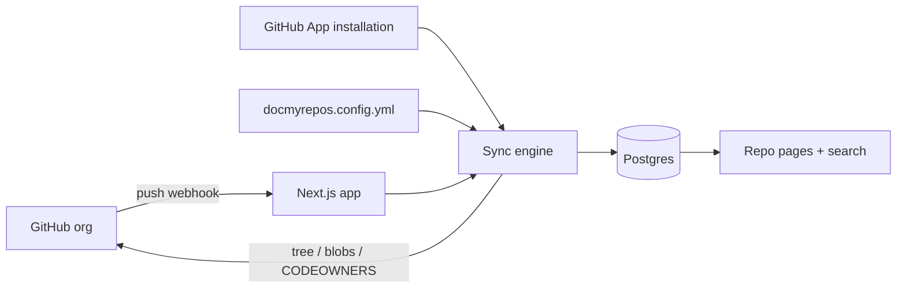

# DocMyRepos

Search and showcase the Markdown documentation of all your GitHub repositories in one place.

DocMyRepos syncs the `docs/` folder of each repo you choose from your GitHub organization, then gives every repo its own space and gives the whole org one search box. It works with plain Markdown and has first-class support for [Open Knowledge Format (OKF)](https://github.com/GoogleCloudPlatform/knowledge-catalog/blob/main/okf/SPEC.md).

> **Status: planning.** The design is written and validated as an OpenSpec change (see [Project status](#project-status)). No application code exists yet, so the quickstart and commands below describe the intended behavior and will change as the code lands.

## Features

- **Per-repo space**: the main README, the code owners from `CODEOWNERS`, and a table of contents of the docs folder.
- **Good-looking Markdown**: GitHub-flavored Markdown, syntax highlighting, and [Mermaid](https://mermaid.js.org) diagrams.
- **Search**: full-text search across every synced repo, with highlighted snippets and a `⌘K` palette.
- **OKF aware**: when a repo uses OKF, filter by concept `type` (plus tags and status), and see each document's metadata.
- **Light and dark themes**: light, dark, or follow the system, including code blocks and diagrams.
- **Fresh content**: GitHub webhooks re-sync a repo when its default branch changes.
- **Self-hostable**: one Next.js app plus Postgres, with Docker Compose.

## How it works



The app reads repos from the GitHub API, stores parsed documents in Postgres, and serves pages from the database. It never calls GitHub while you browse.

## Quickstart (planned)

Requires Node.js 22+, pnpm, and Docker.

```bash
cp .env.example .env                              # set the GITHUB_APP_* values, GITHUB_WEBHOOK_SECRET, SYNC_SECRET
cp docmyrepos.config.example.yml docmyrepos.config.yml
docker compose up                                 # app + Postgres, runs migrations
curl -X POST -H "Authorization: Bearer $SYNC_SECRET" http://localhost:3000/api/sync
```

Then open <http://localhost:3000>.

### Configuration

`docmyrepos.config.yml`:

Everything is optional. With no config, DocMyRepos shows every repository the GitHub App installation can access.

```yaml
repos: # optional: only these repos (must be accessible to the App)
  - name: api-service
  - name: web-app
    docsPath: documentation # override the default docs folder
exclude: [sandbox] # optional: skip these repos
defaults:
  docsPaths: [docs, doc, documentation] # first match wins, case-insensitive
```

| Environment variable         | Purpose                                                                   |
| ---------------------------- | ------------------------------------------------------------------------- |
| `DATABASE_URL`               | Postgres connection string                                                |
| `GITHUB_APP_ID`              | ID of your GitHub App                                                     |
| `GITHUB_APP_PRIVATE_KEY`     | App private key (PEM). Or set `GITHUB_APP_PRIVATE_KEY_PATH` to a key file |
| `GITHUB_APP_INSTALLATION_ID` | ID of the App's installation on your organization                         |
| `GITHUB_WEBHOOK_SECRET`      | Webhook secret (16+ characters) of the GitHub App, verifies signatures    |
| `SYNC_SECRET`                | Secret (16+ characters) that protects the manual `/api/sync` endpoint     |

### GitHub App

DocMyRepos authenticates as a GitHub App, not with a personal access token:

1. Register a GitHub App on your organization with **read-only** permissions for _Contents_ and _Metadata_.
2. Set its webhook URL to `https://<your-host>/api/webhooks/github`, choose a webhook secret, and subscribe to the `push`, `repository`, `installation_repositories` and `installation` events.
3. Generate a private key and install the App on your organization, on all repositories or a selection.
4. Copy the App id, the private key and the installation id into your environment.

The App's single webhook keeps content fresh and tells DocMyRepos when repositories are added to or removed from the installation. For local development, use a tunnel such as `smee.io` or `ngrok`. See the [GitHub App setup guide](docs/github-app-setup.md) for the steps and an [App manifest](docs/github-app-manifest.json).

## Running e2e tests

```bash
pnpm exec playwright install chromium             # once
pnpm db:up                                        # Postgres for the e2e databases (same as docker compose --env-file .env.example up -d --wait db)
pnpm test:e2e
```

`pnpm test:e2e` builds the app once and starts four servers on ports 3100 to 3103: fixture pages without a database, a throwaway database seeded with public and private repositories (`e2e/support/seed-data.ts`), an empty one, and one whose database is unreachable. Each run creates `docmyrepos_e2e_<random>_seeded` and `_empty` databases on the server in `DATABASE_URL_E2E` (default: the compose database from `.env.example`) and drops them afterwards. The servers use a generated throwaway GitHub App key and placeholder secrets; GitHub is never contacted.

Without a reachable Postgres the run fails at once and prints the command above. Set `E2E_SKIP_DB=1` to run only the specs that need no database; the others are skipped with a visible reason.

## Security note

The MVP is single-tenant and has no login. The GitHub App installation reads every repository you grant it, so **anyone who can reach the app can read everything it has synced**. Install the App only on repositories you want shown. If those include private repos, deploy privately or put authentication in front of the app. Private repos are marked with a badge, and the app records each repo's visibility, so per-user access through GitHub OAuth can be added later.

## Project status

The work is specified with [OpenSpec](https://github.com/Fission-AI/OpenSpec) in `openspec/`:

- Active change: [`openspec/changes/docmyrepos-mvp/`](openspec/changes/docmyrepos-mvp/) with the proposal, nine capability specs, design, and the task list.
- Implementation follows `tasks.md` in order.

## Contributing

Contributions are welcome once the scaffold lands. Please open an issue to discuss larger changes first. A full `CONTRIBUTING.md` is part of the planned tasks.

## License

MIT (planned, to be confirmed with the `LICENSE` file).
