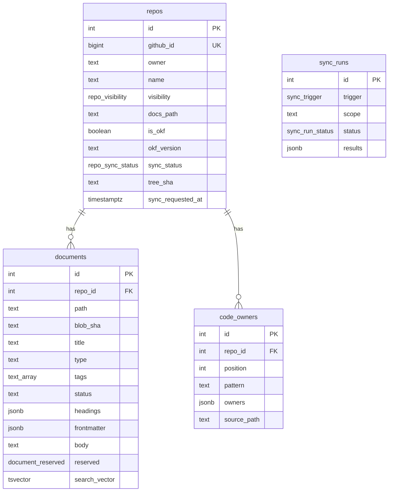

# Data model

The schema is defined with Drizzle in `packages/server/src/db/schema.ts` and targets Postgres 17. Migrations live in `drizzle/` and are forward-only. They are applied by `pnpm db:migrate` on a development machine and by the container entrypoint in production.



## Tables

- **`repos`**: one row per synced repository. `github_id` is GitHub's stable repository id and the identity of the repository's sync lock; `owner` and `name` are unique together. `visibility` is `public` or `private`, has no default, and maps GitHub's `internal` to `private` so it fails closed. The root README is stored as raw Markdown in `readme_markdown`. `tree_sha`, `selection_fingerprint`, `head_etag` and `commit_sha` are the short-circuit state of the [sync engine](./sync-engine.md); they are set only after a fully successful sync. `is_okf` and `okf_version` are computed on every sync. `sync_status` is `pending`, `ok` or `error`, with a fixed `sync_error` message. `sync_warnings` lists the files the last sync left out, and `sync_requested_at` is the rerun marker.
- **`documents`**: one row per Markdown file, unique per `(repo_id, path)`. The stored form is the parsed document: `body` is the Markdown after the frontmatter, `frontmatter` holds every key as authored, `headings` holds `{depth, text, slug}`, and `title` is derived. `type`, `tags` and `status` are columns because they are facets; `type` is free-form text with its case kept and no enum. `reserved` is `index` or `log` for `index.md` and `log.md` at any depth. The OKF display keys (`resource`, `sources`, `generated`, `verified`, `stale_after`) stay in `frontmatter` only, since they are never filtered.
- **`code_owners`**: the rules of the CODEOWNERS file in file order (`position`), each with its pattern and its owners as `{handle, kind}`, where kind is `user`, `team` or `email`. Grouping by owner happens when the page is rendered.
- **`sync_runs`**: one row per run, with counters and a per-repository `results` list that is capped in size. It has no foreign key to `repos`, so history survives the removal of a repository.

Deleting a `repos` row cascades to its documents and code owners.

## Search vector

`documents.search_vector` is a `tsvector` that Postgres generates and stores on every insert and update. Nothing writes it directly. Every input is wrapped in `coalesce`, so a null field never nulls the whole vector.

| Weight | Source                                 |
| ------ | -------------------------------------- |
| A      | `title`                                |
| B      | the `text` of each entry in `headings` |
| C      | `description` and `tags`               |
| D      | `body`                                 |

```sql
-- documents.search_vector, in shortened form
setweight(to_tsvector('simple', coalesce(title, '')), 'A')
|| setweight(jsonb_to_tsvector('simple',
     jsonb_path_query_array(coalesce(headings, '[]'::jsonb), '$[*].text'), '["string"]'), 'B')
|| setweight(to_tsvector('simple', coalesce(description, '')), 'C')
|| setweight(to_tsvector('simple',
     coalesce(docmyrepos_immutable_array_to_string(tags, ' '), '')), 'C')
|| setweight(to_tsvector('simple', coalesce(body, '')), 'D')
```

The text search configuration is `simple`: lower-casing and splitting without stemming or stop words. It is fixed in the migration and exported as `SEARCH_TEXT_CONFIG`; queries must use the same configuration or lexemes would not line up. See [Decision: Postgres full-text search with the simple configuration](../decisions/0001-postgres-fts-simple.md).

At query time, `ts_rank` uses the weights `{0.05, 0.15, 0.4, 1}` for D, C, B and A without length normalization, so one match in a higher field outranks any number of matches in a lower field for a one-word query. The query text is passed to `websearch_to_tsquery` as a bound parameter. See the [search guide](../guides/search.md).

## Indexes and constraints

- GIN index on `search_vector`.
- B-tree on `(repo_id, type)` for the type facet.
- Unique: `(owner, name)` and `github_id` on `repos`, `(repo_id, path)` on `documents`, `(repo_id, position)` on `code_owners`.

## Migrations

Do not squash the migrations and do not use `drizzle-kit push`. Migration `0001` is hand-written SQL: `array_to_string` is only `STABLE`, which Postgres rejects in a generated column, so tags go through an `IMMUTABLE` wrapper over `text[]`. A single-shot generate would emit the column without that function. The search vector is large, so queries other than search list the columns they need instead of selecting whole `documents` rows.
