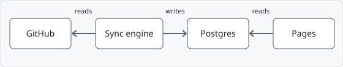
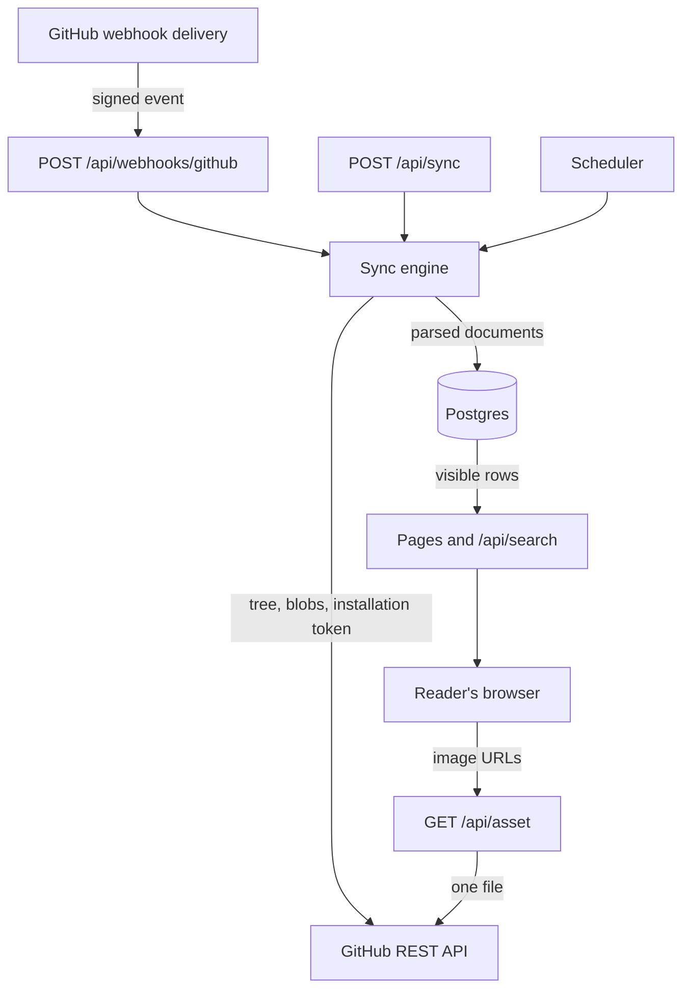
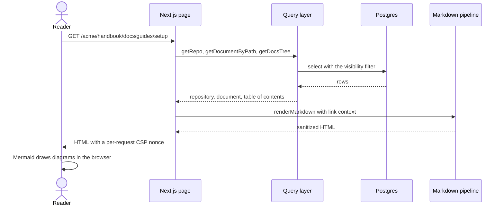

# System overview

DocMyRepos is a single Next.js application (App Router, TypeScript) plus a Postgres database. It runs as one Node.js process. A GitHub App installation gives it read-only access to the repositories you choose.

Two rules shape everything else:

1. **Pages read Postgres only.** Nothing calls GitHub while you browse. The one exception is the image proxy `GET /api/asset/...`, which fetches a single image file.
2. **The sync engine stores parsed documents, not rendered HTML.** Markdown is rendered and sanitized when a page is requested, so a renderer fix needs no re-sync.

## Components

Three things start a sync: a verified webhook, a call to `POST /api/sync`, and the in-process scheduler. All of them run the same [sync engine](./sync-engine.md), which serializes work per repository.

## Request flow

This is what happens for a document page such as `/acme/handbook/docs/guides/setup`.

The page reads three things: the repository, the document, and every document row of the repository. The rows give the sidebar tree, the previous and next links, the breadcrumb and the set of known paths that link rewriting needs.

## Modules

| Path                   | Responsibility                                                                                 |
| ---------------------- | ---------------------------------------------------------------------------------------------- |
| `src/app/`             | Routes: pages and the five API routes.                                                         |
| `src/components/`      | React components. They never touch the database.                                               |
| `src/lib/`             | Pure helpers shared by server and browser: URLs, search params, tree building, OKF display.    |
| `src/server/sync/`     | The sync engine: discovery, tree planning, blob fetching, persistence, runs, scheduler.        |
| `src/server/github/`   | The GitHub client and the App installation token provider.                                     |
| `src/server/docs/`     | Pure parsers: frontmatter, titles and headings, OKF detection, CODEOWNERS, docs folder.        |
| `src/server/markdown/` | The render pipeline: parse, link and image rewriting, highlighting, Mermaid tagging, sanitize. |
| `src/server/queries/`  | Every read of repositories, documents, search and assets, behind one visibility filter.        |
| `src/server/db/`       | Drizzle schema, migrations, advisory locks, the connection pool.                               |
| `src/server/webhooks/` | Signature verification and the event router.                                                   |
| `src/server/assets/`   | The image proxy.                                                                               |

Modules under `src/server/` contain no React, and modules under `src/components/` contain no database access. A static test, `src/server/queries/enforcement.test.ts`, fails when `src/app`, `src/components` or `src/lib` import the database layer, when `src/components` or `src/lib` import the query layer, or when code outside the sync write side reads the `repos`, `documents` or `code_owners` tables around the query layer.

## Trust boundaries

| Boundary                      | What crosses it                        | Control                                                                                   |
| ----------------------------- | -------------------------------------- | ----------------------------------------------------------------------------------------- |
| GitHub to the app (pull)      | Repository lists, trees, file contents | Installation token, read-only permissions, held in memory only                            |
| GitHub to the app (push)      | Webhook deliveries                     | HMAC-SHA256 signature over the raw body                                                   |
| Operator to the app           | `POST /api/sync`                       | `Authorization: Bearer` with `SYNC_SECRET`, compared in constant time                     |
| Repository content to readers | Markdown, frontmatter, images          | Treated as untrusted: sanitized after all transforms, CSP with nonce, Mermaid strict mode |
| Reader to the app             | Page, search and image reads           | No login in the MVP; one visibility filter in the query layer                             |

The portal has no login. Anyone who can reach it can read everything it has synced, so a deployment that syncs private repositories must sit behind network rules or an authenticating proxy. The [security model](./security.md) lists each control and what it does not cover.

## Related

- Configuration keys and environment variables: [Configuration](../guides/configuration.md).
- Endpoint details: [HTTP API reference](/reference/api.md).
