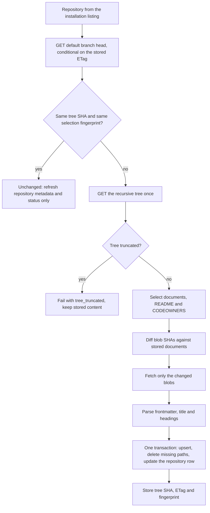
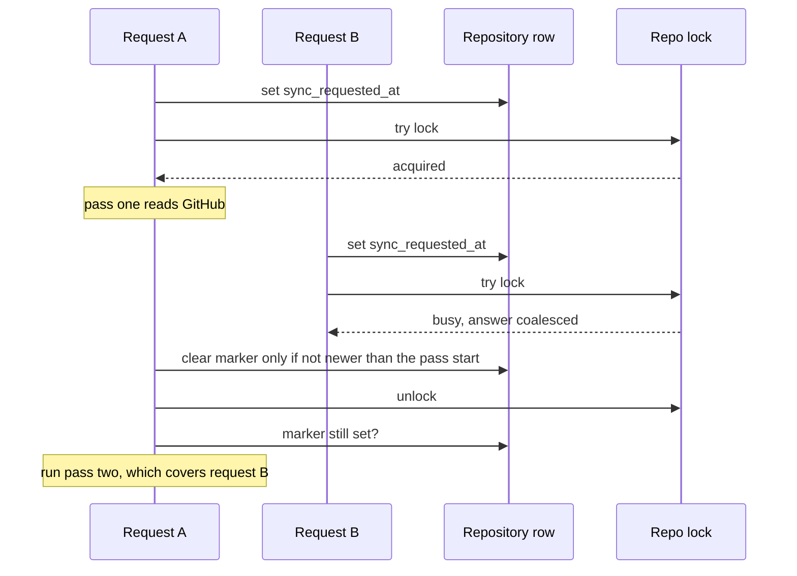

# Sync engine

The sync engine is the only writer of repository content. It lives in `src/server/sync/` and reads GitHub through a small `fetch`-based client authenticated with a GitHub App installation token. Everything it learns ends up in Postgres, in one transaction per repository.

The entry points in `engine.ts`:

- `syncAll` is a full run. It lists the repositories the installation can access, narrows them by [configuration](../guides/configuration.md), syncs each one, and removes stored repositories that are no longer selected.
- `requestSync` syncs one repository for `POST /api/sync` and for [webhooks](../guides/webhooks.md). It records a rerun marker first, so a request that arrives while the repository is busy is not lost.
- `drainSyncRequests` runs every repository that still has a waiting marker. A full run calls it at the end, and the scheduler calls it every minute.

Every run is recorded in `sync_runs` with a trigger (`webhook`, `manual`, `startup` or `schedule`), a scope (`owner/name`, or null for all) and a status (`success`, `partial` or `failed`).

## One repository

1. **Head check.** The branch head request sends the stored ETag. A `304` costs no rate limit. An unchanged repository costs one request.
2. **Fingerprint.** The tree SHA alone is not enough, because a config change (docs folder override, file size cap, document cap) changes the selection without changing the tree. The _selection fingerprint_ is a hash of every setting that affects which files are picked, plus a rules version. The plan is `unchanged` only when both match.
3. **Selection.** The docs folder is the per-repository `docsPath` override if set (authoritative, no fallback), else the first of `docs`, `doc`, `documentation` that exists, matched case-insensitively. Documents are regular files ending in `.md` or `.mdx` below it. Skipped, and reported as warnings: files over the size cap, dot-prefixed files and folders, `node_modules`, symlinks, and everything past the document cap (the first files in path order are kept). The root README (`README.md`, `.markdown`, `.mdx` or no extension) and the CODEOWNERS file (`.github/CODEOWNERS`, then `CODEOWNERS`, then `docs/CODEOWNERS`) are picked the same way.
4. **Diff and fetch.** Planned files are compared with stored blob SHAs by exact path. Only new or changed blobs are fetched, 8 at a time, within a 64 MiB budget. A renamed file is a removal plus an addition.
5. **Persist.** The repository row, documents, README and code owners are written in one transaction, with a savepoint per document, so one document that Postgres refuses never fails the others.

Syncing is idempotent: running the same sync twice writes nothing the second time, because documents whose stored values already match are not touched.

## Limits

| Limit                    | Default | Setting                 | Behaviour when exceeded                                    |
| ------------------------ | ------- | ----------------------- | ---------------------------------------------------------- |
| Documents per repository | 2000    | `limits.maxDocsPerRepo` | The first files in path order are kept; a warning is shown |
| Size of one file         | 256 KB  | `limits.maxFileBytes`   | The file is skipped; a warning is shown                    |
| Blob requests in flight  | 8       | none (code default)     | Queued                                                     |
| Repositories at once     | 1       | none (code default)     | Queued; clamped to what the connection pool can serve      |

The 256 KB file cap is also the maximum, because a document's search vector must stay far below the 1 MB tsvector limit of Postgres.

## Serialization and locks

Syncs of one repository never overlap. The engine takes a session-level Postgres advisory lock per repository, in try mode, so a second request does not wait; it is _coalesced_ (below). The lock key is the first 8 bytes of SHA-256 over a namespace and the repository's GitHub id. The GitHub id is used, not `owner/name`, so a rename during a sync cannot let two syncs overlap. A lock dies with its connection, so a crashed process never leaves a repository locked. Each run also holds a run lock for its whole duration, which lets a reaper tell a live `running` row in `sync_runs` from one left by a dead process; rows older than a one-minute grace period without a held lock are marked `failed`.

Session locks need a direct connection to Postgres, or a pooler in session mode. See [Decision: advisory locks, no queue](../decisions/0002-advisory-locks-no-queue.md).

## Coalescing

A request that finds the repository busy must not be dropped. Otherwise a push that lands after the running sync fetched its tree would stay unsynced.

The marker is `repos.sync_requested_at`. A pass takes a database instant before it reads GitHub, and clears the marker only if the marker is not newer than that instant. After unlocking, the holder looks again and runs another pass if a request arrived meanwhile, at most 5 passes per call. A pass that was aborted, lost its lock, or could not list the installation leaves the marker for the next trigger. A repository with no row yet cannot hold a marker, so webhook-driven requests for it retry with backoff, and `POST /api/sync` answers `409`.

Deliveries are not deduplicated by `X-GitHub-Delivery`. Syncing is idempotent, and GitHub's Redeliver button reuses the id, so a manual redelivery must still sync.

## Failure handling

- A failed repository keeps its previously stored content. It is marked `sync_status = error` with a fixed message.
- Some errors stop the whole run because continuing would fail the same way: rate limit exhausted, unauthorized, bad App credentials, an unusable private key, an unavailable installation, and an abort. The client waits out a rate limit when GitHub's wait fits its budget; otherwise it fails at once with the retry time.
- If some files could not be fetched, the content that did arrive is written, but the stored tree SHA, ETag and fingerprint are cleared, so the next sync re-plans and fetches only the missing files.
- A truncated recursive tree fails the repository with `tree_truncated`. There is no per-directory fallback, because planning from a partial tree would delete the documents the listing left out.

## Removal rule

A stored repository is deleted (the row cascades to documents and code owners) only on an authoritative signal:

- it is absent from a **complete** installation listing, confirmed by a second listing, because offset pagination can miss a repository when the set shifts between pages;
- it is dropped from `repos`, matched by `exclude`, or archived upstream;
- a verified webhook reports it deleted, archived, or removed from the installation.

Nothing is deleted on a failed or partial listing, a transient `404`, or a failed repository fetch. When the installation is deleted or suspended, every repository is marked `error` and all content is kept. The delete itself re-checks inside the transaction that the repository was not rediscovered and was not written after the listing was taken, so a repository synced concurrently is not removed on stale information. Unarchiving brings a repository back on the next sync.

## Scheduler

Webhooks are the fast path. A background scheduler is the fallback for lost deliveries. It runs in the server process, started from `src/instrumentation.ts`:

- one full sync about 10 seconds after start (`sync.onStartup`), trigger `startup`;
- a full sync every `sync.intervalMinutes` (default 60, `0` turns it off, otherwise at least 5), trigger `schedule`, with plus or minus 10 percent jitter, timed from the end of the previous run;
- after a failed run, a retry after 1 minute, doubling per consecutive failure up to 15 minutes, never later than the normal interval;
- every minute, a drain of waiting rerun markers;
- among several instances, one cluster-wide advisory lock lets only one run a scheduled full sync at a time.

The scheduler is on when `NODE_ENV=production` and off otherwise, so `pnpm dev` never calls GitHub on its own. `SYNC_SCHEDULER=1` or `0` overrides that. See [Configuration](../guides/configuration.md#scheduler).
