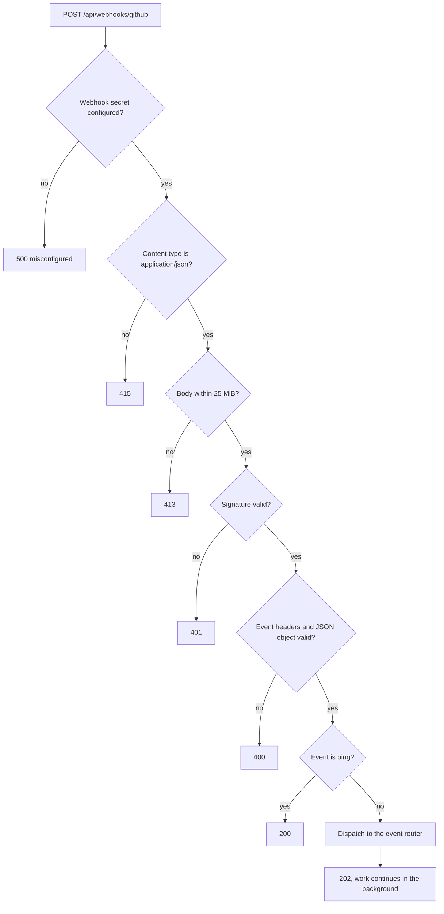

# Webhooks

The GitHub App has one webhook. It tells DocMyRepos when a repository's default branch changes and when repositories are added to or removed from the installation, so content stays fresh without waiting for the scheduled sync. The URL is `https://<your-host>/api/webhooks/github`. How to configure it is covered in [GitHub App setup](../github-app-setup.md#4-webhook).

## Events

DocMyRepos handles four events. Every handled event must carry the configured installation id; events for another installation of the same App are ignored.

| Event                       | Action                                                         | Result                                                                                                           |
| --------------------------- | -------------------------------------------------------------- | ---------------------------------------------------------------------------------------------------------------- |
| `push`                      | to the default branch, not a branch deletion                   | Sync that repository, if it is selected by the config and not archived.                                          |
| `repository`                | `created`, `edited`, `transferred`, `publicized`, `unarchived` | Sync the repository if it is selected and not archived.                                                          |
| `repository`                | `renamed`                                                      | Sync it if the new name is selected, otherwise remove it.                                                        |
| `repository`                | `privatized`                                                   | Mark it private at once, then sync it.                                                                           |
| `repository`                | `deleted`, `archived`                                          | Remove the stored repository.                                                                                    |
| `installation_repositories` | `added`                                                        | Sync each added repository that is selected. A full sync when the selection is `all` or more than 10 were added. |
| `installation_repositories` | `removed`                                                      | Remove each listed repository.                                                                                   |
| `installation`              | `deleted`, `suspend`                                           | Mark every repository `error` and keep all content.                                                              |
| `installation`              | `unsuspend`, `created`, `new_permissions_accepted`             | Start a full sync.                                                                                               |
| `ping`                      |                                                                | Answer `200`, do nothing.                                                                                        |

Any other event, any other action, and any payload whose used fields do not validate is acknowledged and ignored.

## How a delivery is processed



The order matters: nothing is parsed and nothing touches the database before the signature checks out.

### Signature

GitHub signs each delivery with HMAC-SHA256 over the exact bytes of the body, keyed with the webhook secret, and sends `X-Hub-Signature-256: sha256=<64 lowercase hex characters>`. DocMyRepos hashes the raw bytes it received and compares in constant time. Uppercase hex, a wrong length, a repeated header and the legacy `X-Hub-Signature` (SHA-1) header are all rejected. A secret shorter than 16 characters never verifies, and every delivery then gets `500`.

To test a deployment without GitHub, sign a `ping` yourself:

```bash
payload='{"zen":"test"}'
sig="sha256=$(printf '%s' "$payload" | openssl dgst -sha256 -hmac "$GITHUB_WEBHOOK_SECRET" -hex | sed 's/^.* //')"
curl -i -X POST http://127.0.0.1:3000/api/webhooks/github \
  -H "Content-Type: application/json" \
  -H "X-GitHub-Event: ping" \
  -H "X-Hub-Signature-256: $sig" \
  -d "$payload"
```

Expect `200` with `{"ok":true,"event":"ping"}`. Change one character of the payload after signing and expect `401`.

### Answering quickly

The handler waits up to 5 seconds for the router, well inside GitHub's 10 second delivery timeout. Syncs and removals are never awaited: the router starts them in the background and answers `202`. Only two single-statement updates are awaited, because they must not be lost: marking a repository private on `privatized`, and marking repositories `error` when the installation is deleted or suspended. If one of those fails, or the router throws within the wait, the answer is `500` and GitHub records a failed delivery that you can redeliver.

## Idempotency and repeated events

Processing is idempotent, and deliveries are not deduplicated by `X-GitHub-Delivery`:

- Syncing an unchanged repository fetches no tree and no blobs: after the installation listing and one conditional branch request, the stored tree SHA and ETag short-circuit the work.
- A push that arrives while the repository is syncing is _coalesced_: it sets a rerun marker, and the running sync runs again when it finishes. See [Coalescing](../architecture/sync-engine.md#coalescing).
- GitHub's Redeliver button reuses the delivery id, so deduplicating on it would make a manual redelivery do nothing.
- Order is not assumed. A sync reads the installation listing first, so a late `push` for a repository that was deleted finds nothing and creates nothing.

A webhook removal waits up to 30 seconds for a running sync of the same repository. If it gives up, the next full sync removes the repository.

## When nothing happens

If a delivery shows `202` but the portal does not change, the event was ignored by design: another branch, a repository outside `repos` or `exclude`, another installation id, or an unhandled event. The `webhook.decision` log line says which, with a reason. The troubleshooting table in [GitHub App setup](../github-app-setup.md#troubleshooting) lists the other causes, and [Operations](../reference/operations.md#logs) describes the log fields.
